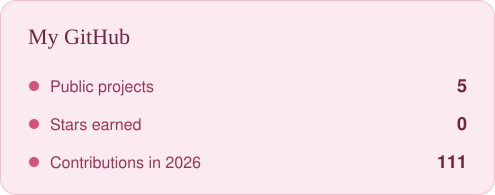
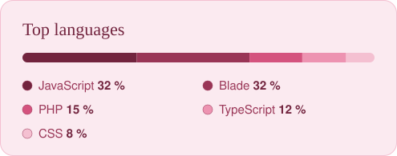

  

  
  
  
  
  
  
  
  
  
  
  
  

## About me

I'm Darleen, an E-Commerce student at the Technical University of Applied Sciences Würzburg-Schweinfurt (THWS). In my free time I turn everyday problems into small, carefully designed apps, mostly for macOS and mobile. I also work as a math tutor, which taught me to explain things clearly.

## Currently working on

**My Monthly Muse**, a Mac app that replaces my monthly notes with a freely arrangeable mood board: to-dos, habits, goals, weather, a cycle tracker and a new look every month.

## Projects

| Project | What it is | Built with |
| --- | --- | --- |
| [Nachhilfe-Planer](https://github.com/darleenfritz/nachhilfe-planer) | Organizer for my tutoring: students, schedule, holidays, invoices | Electron, JavaScript |
| [Recipe Collector](https://github.com/darleenfritz/recipe-collector) | Recipe app with an AI assistant that reads photos and understands speech | React Native, Expo, Firebase, OpenAI |
| [FritzAbo](https://github.com/darleenfritz/fritzabo) | Web app to manage subscriptions | Laravel, PHP, MySQL |
| [Simple Shop](https://github.com/darleenfritz/simpleshop) | REST backend for an online shop with JWT login | Django, Django REST Framework |
| [Desktop Cats](https://github.com/darleenfritz/desktop-cats) | My two cats as animated companions on the desktop | Electron, JavaScript |

## Stats

  
  

## Let's connect

